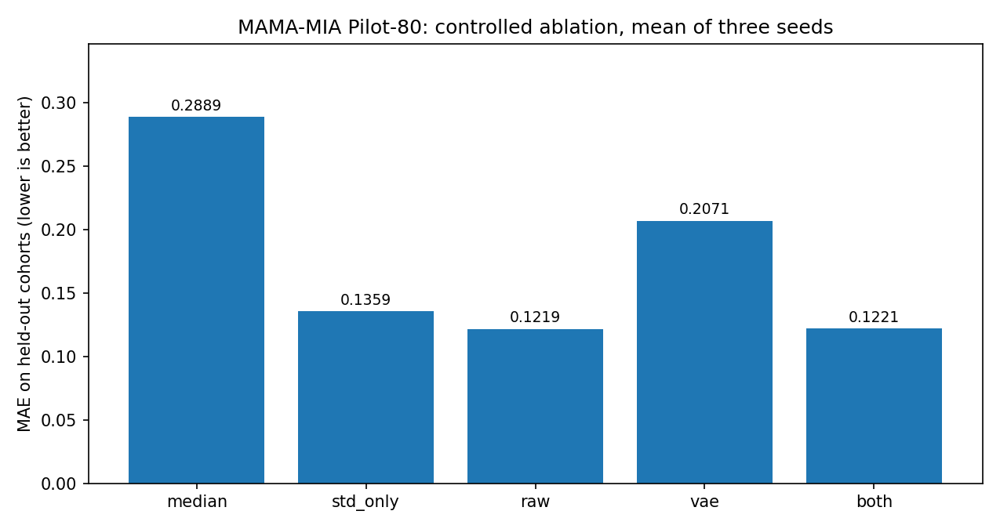

# MAMA-MIA LatentLab

**An independent, reproducible research pilot using breast DCE-MRI, tumor masks, a tabular VAE and a texture surrogate.**

I started this project with a question: can a small variational autoencoder (VAE) learn useful information from MRI-derived tumor features that ordinary features do not already capture? I used the published [MAMA-MIA](https://www.synapse.org/Synapse:syn60868042) dataset to build a practical pipeline, test it across source cohorts and check this claim rather than assume it.

The most useful result so far is a negative one: **the VAE did not improve a texture surrogate beyond the original image-summary features.** I am keeping that result visible. This is a research prototype, not clinical software or a validated biomarker, and it is independent of the original MAMA-MIA team.

## Completed work

- Extracted 12 geometric and intensity summaries and a separately measured local 3D texture statistic from **80 real cases**, 20 each from DUKE, ISPY1, ISPY2 and NACT, with expert tumor masks.
- Trained a small VAE on the 12 tabular features, then used UMAP for exploratory visualization and a random forest to estimate the image-derived texture statistic.
- Evaluated the surrogate by **leave-one-source-cohort-out**: 60 training cases, 20 held-out cases, repeated for all four sources.
- Compared original features, VAE latents, their combination, a one-feature model and a training-median baseline. Repeated with seeds 42, 123 and 2026.
- Downloaded a third MRI phase for all 80 cases and checked timing metadata (**79 valid sequences, one incomplete**). The proposed temporal analysis is **not yet a completed or validated experiment**.

The sample was intentionally balanced on pCR within each source cohort for a small engineering study, so it is **not representative of response prevalence**. The pCR label was not used in VAE fitting, the surrogate target or model selection; **no treatment-response predictor was trained**.

## Ablation results (pilot, exploratory)

| Surrogate inputs | Pooled MAE ↓ | Pooled R² ↑ |
|:--|--:|--:|
| Training-median baseline | 0.2889 | −0.193 |
| Single image-intensity feature | 0.1359 | 0.742 |
| **12 MRI summary features** | **0.1219** | **0.773** |
| 4 VAE latent means only | 0.2071 | 0.337 |
| 12 features + VAE latent means | 0.1221 | 0.769 |

Mean pooled results over three seeds, each with 80 held-out patient predictions across four cohort folds. The three seeds reuse the same people and are *not* three independent cohorts. The paired difference, `MAE(raw) − MAE(raw + VAE)`, was approximately `−0.00020` (cohort-stratified patient-bootstrap 95% percentile interval `[−0.00223, 0.00178]`). **This study does not demonstrate an added benefit from the current VAE.** A simpler single-feature baseline also works surprisingly well, suggesting that the target may be strongly related to intensity variation in the same images.



[Aggregate results](results_public/) · [Full ablation discussion](docs/ABLATION_REPORT.md) · [Protocol and limitations](docs/STUDY_PROTOCOL.md) · [Temporal extension notes](docs/TEMPORAL_NEXT_STEPS.md).

## Run locally (Linux / Python 3.12)

```bash
python3 -m venv .venv
source .venv/bin/activate
python -m pip install -r requirements.txt
python -m pytest -q
```

Synthetic smoke test — no real patient data required:

```bash
python -m latentlab demo --out results/demo.csv --n 100
python -m latentlab analyze --input results/demo.csv \
  --holdout-cohort DUKE --epochs 30 --out results/demo
```

For actual MAMA-MIA data, obtain access through the [official Synapse project](https://www.synapse.org/Synapse:syn60868042), review its terms and keep data **locally**. Optional dependency install: `python -m pip install -r requirements-download.txt`.

```bash
# Requires local ~/MAMA-MIA-data/clinical_and_imaging_info.xlsx
# Preview patient selection first. Download requires Synapse authentication.
python mamamia_batch.py --per-cohort 20 --out results/pilot80_manifest.csv
python mamamia_batch.py --per-cohort 20 --download --out results/pilot80_manifest.csv

python -m latentlab extract \
  --manifest results/pilot80_manifest.csv --out results/pilot80_extract

python ablation_pilot80.py \
  --input results/pilot80_extract/radiomic_features.csv \
  --out results/pilot80_ablation \
  --epochs 80 --seeds 42,123,2026 --bootstrap 1000
```

Scripts `mamamia_phase2.py` and `mamamia_temporal_extract.py` support a *future* three-phase analysis. Their presence in this repository does not imply completed temporal model results. See [temporal notes](docs/TEMPORAL_NEXT_STEPS.md).

## Limits that matter

- The VAE operates on **12 hand-engineered measurements**, *not* the full 3D MRI volumes. Its latent variables cannot be presented as clinically validated imaging phenotypes.
- The supervised surrogate estimates `spatial_neighbor_difference_q90`, a computable MRI statistic. **It does not predict pCR, cancer subtype, patient survival or treatment response.**
- Predictors and target are measured from the same MRI and expert tumor mask. This is a substantial proxy-overlap/shortcut risk.
- The four **source collections are not necessarily four independent hospitals**. Scanner manufacturer, voxel spacing and acquisition protocols can confound observed relationships.
- UMAP is descriptive. Neither two-dimensional separation nor overlap establishes a biological subtype or successful harmonization.
- Image-axis labels, spacing dependence of neighbor differences and intensity reference choices remain methodological limitations.
- Model-development decisions made after inspecting held-out results mean these are preliminary pilot estimates, not a locked external clinical validation.

## Data provenance and reuse

Original dataset: Garrucho, L., Kushibar, K., Reidel, C.-A. et al. *A large-scale multicenter breast cancer DCE-MRI benchmark dataset with expert segmentations*. **Scientific Data 12**, 453 (2025). https://doi.org/10.1038/s41597-025-04707-4

Sources: [MAMA-MIA dataset](https://www.synapse.org/Synapse:syn60868042) · [original MAMA-MIA code](https://github.com/LidiaGarrucho/MAMA-MIA). The constituent TCIA datasets (I-SPY1, I-SPY2, Duke, NACT-Pilot) have their own attribution/license obligations; follow original terms. **No MRI files, masks, clinical spreadsheets, patient-level features, linked predictions or access tokens are published here.** Only aggregate pilot metrics are included.

The **code** is shared under the MIT License. This does **not** relicense any source imaging, masks or clinical data. No endorsement or affiliation with Karolinska Institutet or MAMA-MIA investigators is claimed.
